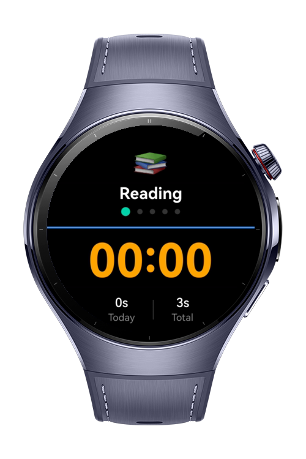
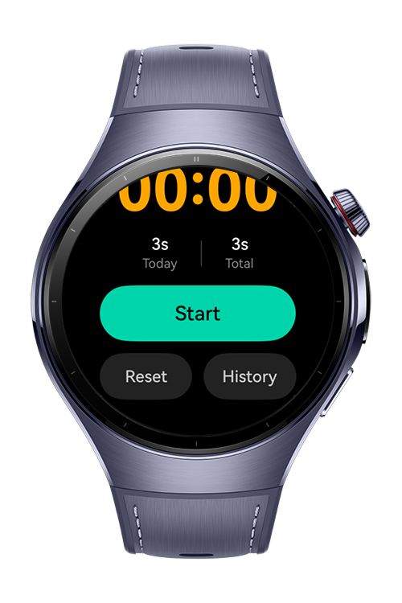
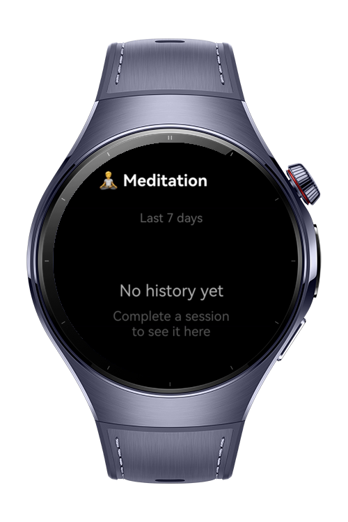

> **Note:** To access all shared projects, get information about environment setup, and view other guides, please visit [Explore-In-HMOS-Wearable Index](https://github.com/Explore-In-HMOS-Wearable/hmos-index).

# How To Use Timer Functionality

This application demonstrates habit tracking with timer functionality for HarmonyOS wearable devices. It uses the Preferences API for key-value persistence and RelationalStore for session history, and provides a wearable-optimized interface for tracking time spent on daily habits like reading, exercise, meditation, study, and practice.

# Preview

<div>
  
   
  
</div>

# Use Cases

- Daily Habit Tracking: Track time spent on important habits with automatic daily reset at midnight.
- Habit Selection: Swipe left or right on the main screen to switch between habits. The Digital Crown also cycles through habits with a degree-based threshold to prevent accidental skips.
- Focus Timer: Use as a stopwatch to measure time spent on activities with start/stop/reset controls. The timer continues running in the background when the wrist is lowered.
- Progress Monitoring: View today's duration and lifetime total for each habit on the main screen.
- Session History: Browse the last 7 days of logged sessions per habit with an inline bar chart.
- Session Notifications: Receive a wrist notification when a session is stopped, confirming the habit name and duration logged today.
# Technology

## Stack
 
* **Languages:** ArkTS
* **Frameworks:** HarmonyOS SDK 5.1.0 (API 18)
* **Tools:** DevEco Studio 5.1.0 or later
* **Libraries:** 
  * `@kit.AbilityKit`, 
  * `@kit.ArkUI`, 
  * `@kit.ArkData` (Preferences API, RelationalStore), 
  * `@kit.BackgroundTasksKit`, 
  * `@kit.NotificationKit`

## Required Permissions
* `"ohos.permission.KEEP_BACKGROUND_RUNNING"`

# Directory Structure

```
entry/src/main/ets/
|---entryability
|   |---EntryAbility.ets              // Application lifecycle, notification permission request
|---constants
|   |---DbConstants.ets               // RelationalStore table and column name constants
|   |---StorageKeys.ets               // Preferences storage key constants
|---models
|   |---DefaultHabits.ets             // Default habit definitions
|   |---Habit.ets                     // Habit, TimerState, DailyRecord interfaces
|---pages
|   |---HistoryPage.ets               // 7-day session history with bar chart
|   |---Index.ets                     // Main UI — swiper navigation, timer, today/total display
|---services
|   |---HabitService.ets              // Timer logic, background task, session notification
|   |---HistoryService.ets            // RelationalStore wrapper for session history
|   |---PreferencesService.ets        // Key-value persistence wrapper
|---viewmodels
|   |---HistoryViewModel.ets          // History page state and data logic
|   |---IndexViewModel.ets            // Main page state, timer control, crown navigation
```

# Constraints and Restrictions

## Supported Device

- Huawei Watch 5

## Limitations

- Habits are pre-configured in code; no UI to add/remove/edit habits.
- Session history is stored on-device only; no phone sync.
- Background task uses dataTransfer mode — the closest wearable-supported mode for timer persistence.
- Notification permission must be granted by the user at first launch; session-end notifications will not appear if denied.
# License

HabitTimer is distributed under the terms of the MIT License.

See the [LICENSE](/LICENSE) for more information.
